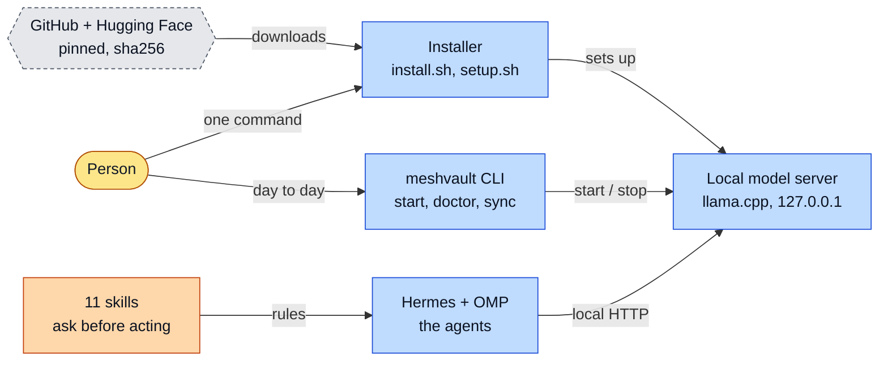
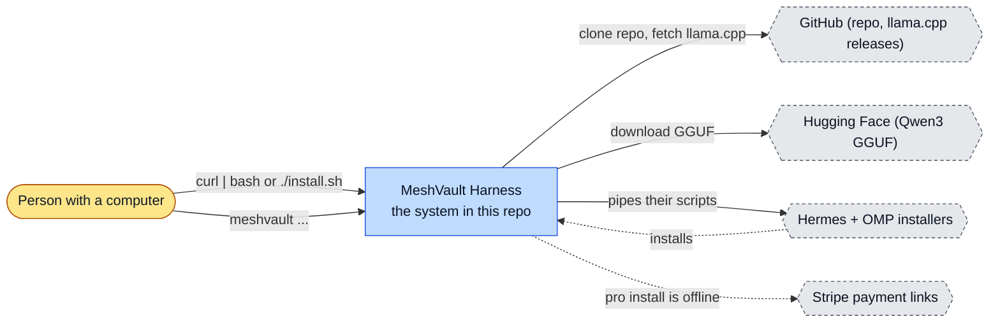
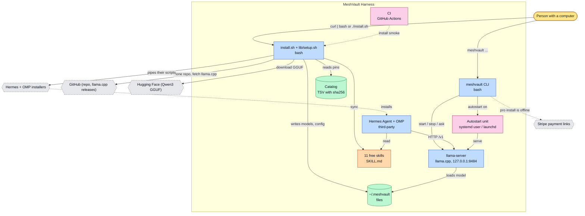
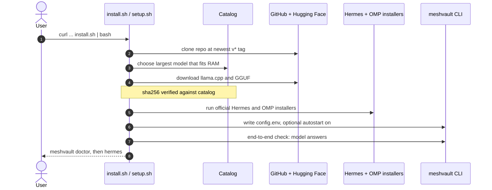
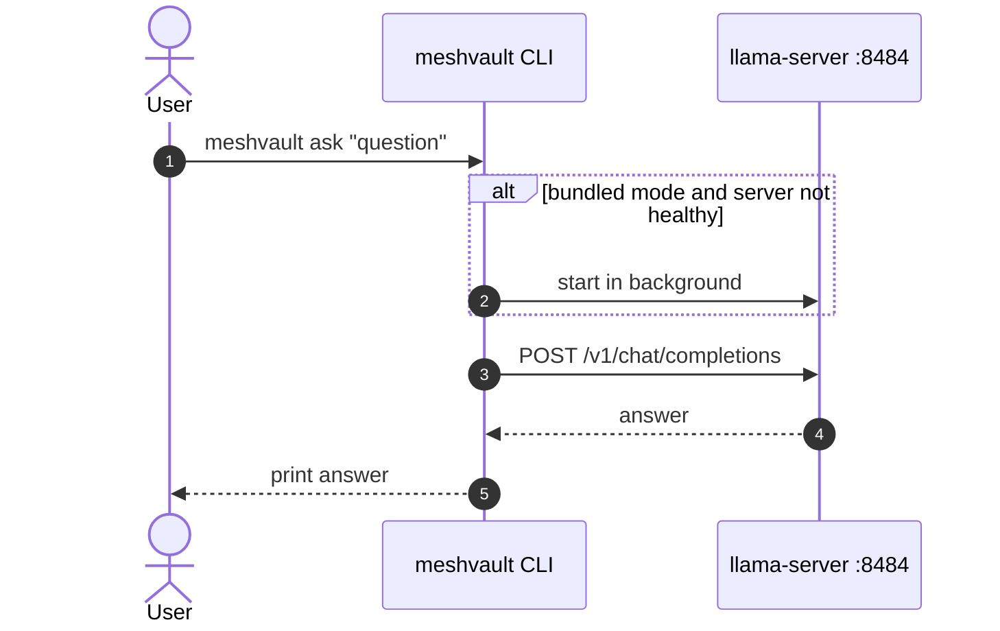
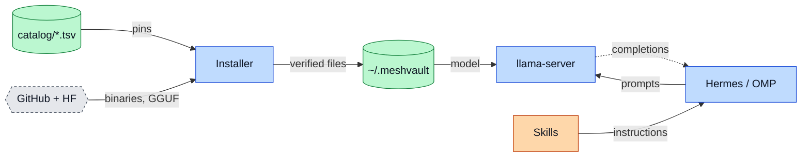
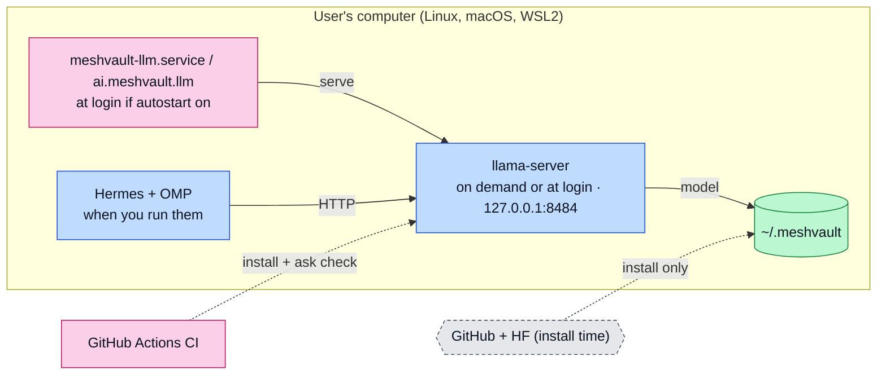

# MeshVault Harness: architecture

<!-- arch-kit:generated -->

> Whiteboard-level structure: what systems exist, what they talk to, and when they run. Evidence-backed; every box below maps to a path listed in [Evidence](#10-evidence).
> Generated by the ArchDocs kit from repo commit `cc434cb4bb`. Diagram sources: [`architecture/*.mmd`](architecture/). Hi-res renders sit next to each source.

## 1. Purpose

MeshVault Harness gives a person an AI agent that runs on their own computer with no account and no API key. `install.sh` clones this repo and `lib/setup.sh` downloads a pinned llama.cpp server and one sha256-checked Qwen3 model, then installs Hermes Agent and OMP with their own official installers and points both at the local model on 127.0.0.1. 11 Markdown skills tell the agent to draft, show and wait before it sends, pays, posts or deletes. A `meshvault` command starts and stops the model, runs a doctor, syncs skills and installs the paid Pro pack.

## 2. Whiteboard view

Seven boxes. Everything the agent thinks with runs on your machine; the network is only used to install.



Hi-res: [SVG](architecture/whiteboard.svg) · [PNG 3x](architecture/whiteboard@3x.png) · [dark SVG](architecture/whiteboard.dark.svg) · [dark PNG 3x](architecture/whiteboard.dark@3x.png)

Explorable version (Archify, standalone HTML, download and open locally): [`architecture/meshvault-harness.archify.html`](architecture/meshvault-harness.archify.html)

## 3. System context (C4 level 1)

Who and what touches the system from outside.



Hi-res: [SVG](architecture/context.svg) · [PNG 3x](architecture/context@3x.png)

## 4. Containers and components (C4 level 2)

The parts that run or hold data inside the repo's system boundary.



Hi-res: [SVG](architecture/containers.svg) · [PNG 3x](architecture/containers@3x.png)

| Container | Kind | Tech | What it does | Evidence |
|---|---|---|---|---|
| install.sh + lib/setup.sh | app | bash | Clone, pick model by RAM, download and verify, install agents, write config, optional autostart, final check. | [`install.sh`](../install.sh), [`lib/setup.sh#L82-L90`](../lib/setup.sh#L82-L90), [`lib/setup.sh#L177-L178`](../lib/setup.sh#L177-L178) |
| meshvault CLI | app | bash | serve, start, stop, status, ask, doctor, model, skills, pro, autostart, update, uninstall. | [`bin/meshvault#L307-L326`](../bin/meshvault#L307-L326) |
| Catalog | store | TSV with sha256 | Pinned llama.cpp build b11430 and four Qwen3 model files with checksums. | [`catalog/runtime.tsv`](../catalog/runtime.tsv), [`catalog/models.tsv`](../catalog/models.tsv) |
| llama-server | app | llama.cpp, 127.0.0.1:8484 | One model, one slot, 64K context, q8 KV cache. Bound to loopback only. | [`bin/meshvault#L58-L68`](../bin/meshvault#L58-L68) |
| ~/.meshvault | store | files | harness clone, models/*.gguf, runtime/, config.env, logs, optional pro/. | [`lib/setup.sh#L199-L201`](../lib/setup.sh#L199-L201), [`bin/meshvault#L47-L49`](../bin/meshvault#L47-L49) |
| Hermes Agent + OMP | app | third-party | Installed by their own scripts and configured to use the local OpenAI-compatible endpoint. | [`lib/setup.sh#L221-L260`](../lib/setup.sh#L221-L260) |
| 11 free skills | doc | SKILL.md | Plain Markdown. Skills that can send, pay, post or delete carry an Approval Gate section. | [`skills/invoice-chaser/SKILL.md`](../skills/invoice-chaser/SKILL.md), [`skills/inbox-triage/SKILL.md`](../skills/inbox-triage/SKILL.md) |
| Autostart unit | job | systemd user / launchd | meshvault-llm.service or ai.meshvault.llm runs `meshvault serve` at login when enabled. | [`bin/meshvault#L210-L262`](../bin/meshvault#L210-L262) |
| CI | job | GitHub Actions | Static checks, gitleaks, sanitizer, plus a real model-only install and answer on Ubuntu 24.04. | [`.github/workflows/ci.yml`](../.github/workflows/ci.yml) |

## 5. Key runtime sequences

### 5.1 One-command install

Downloads are pinned and sha256-checked, except the two third-party agent installers, which are piped to the shell.



Hi-res: [SVG](architecture/sequence-1.svg) · [PNG 3x](architecture/sequence-1@3x.png)

### 5.2 meshvault ask



Hi-res: [SVG](architecture/sequence-2.svg) · [PNG 3x](architecture/sequence-2@3x.png)

## 6. Data flow and stores

Weights and the runtime come in once, pinned. At runtime the only traffic is loopback HTTP between the agents and the model.



Hi-res: [SVG](architecture/dataflow.svg) · [PNG 3x](architecture/dataflow@3x.png)

| Store | What it holds | Written by | Evidence |
|---|---|---|---|
| ~/.meshvault | Harness clone, models, runtime, config.env, logs, pro pack. | installer, meshvault CLI | [`lib/setup.sh#L199-L201`](../lib/setup.sh#L199-L201), [`bin/meshvault#L47-L49`](../bin/meshvault#L47-L49) |
| catalog/*.tsv | Pinned runtime build and model files with sha256. | Maintainers (git) | [`catalog/runtime.tsv`](../catalog/runtime.tsv), [`catalog/models.tsv`](../catalog/models.tsv) |
| ~/.hermes/skills and ~/.omp/agent/skills | Copies of the skills; `.meshvault-managed` marks what sync may replace. | meshvault skills sync | [`bin/meshvault#L157-L181`](../bin/meshvault#L157-L181) |

## 7. Deployment and runtime topology

Everything lives on one user account. The model server starts on demand or at login; nothing is exposed to the network.



Hi-res: [SVG](architecture/deployment.svg) · [PNG 3x](architecture/deployment@3x.png)

| What | Where | Runs when | Trigger / port | Evidence |
|---|---|---|---|---|
| Model server | User's computer | On `meshvault start` or `ask`, or at every login with autostart | 127.0.0.1 port 8484 | [`bin/meshvault#L58-L90`](../bin/meshvault#L58-L90) |
| Autostart unit | systemd user / launchd | At login | `meshvault autostart on` | [`bin/meshvault#L210-L262`](../bin/meshvault#L210-L262) |
| Idle sleep | llama-server | After 1800 s idle | --sleep-idle-seconds 1800 | [`bin/meshvault#L67-L68`](../bin/meshvault#L67-L68) |
| CI | GitHub Actions, Ubuntu 24.04 | Every push to main and every PR | checks + install-smoke jobs | [`.github/workflows/ci.yml#L2-L5`](../.github/workflows/ci.yml#L2-L5), [`.github/workflows/ci.yml#L28-L39`](../.github/workflows/ci.yml#L28-L39) |

## 8. Failure modes and how to see them

| Failure | What the user sees | How to see it | Evidence |
|---|---|---|---|
| Download interrupted or checksum mismatch | Install stops; rerun resumes | installer output, `$MV_HOME/logs/` | [`lib/setup.sh#L177-L178`](../lib/setup.sh#L177-L178) |
| Hermes or OMP installer fails | OMP failure is a warning; Hermes failure stops the install | `$MV_HOME/logs/hermes-install.log`, `omp-install.log` | [`lib/setup.sh#L227-L228`](../lib/setup.sh#L227-L228), [`lib/setup.sh#L254-L255`](../lib/setup.sh#L254-L255) |
| Model server down | Agents cannot answer | `meshvault status`, `meshvault logs` | [`bin/meshvault#L106-L109`](../bin/meshvault#L106-L109), [`bin/meshvault#L125-L128`](../bin/meshvault#L125-L128) |
| CPU-only box, long first Hermes message | Minutes before the first reply | Documented in README; use `meshvault ask` or `--gpu vulkan` | [`README.md#L73-L80`](../README.md#L73-L80) |
| Approval Gate ignored by the model | Agent acts without asking: the gate is an instruction, not a permission | Keep the agent's own approval settings on | [`README.md#L119-L120`](../README.md#L119-L120) |

## 9. State machine

The only long-lived entity is the model server, which is simply up or down (`meshvault status`). It has no lifecycle states worth a state diagram.

## 10. Evidence

Every path below exists at the pinned commit; links are relative to `docs/`.

| Path | Why it matters |
|---|---|
| [`lib/setup.sh`](../lib/setup.sh) | The installer: OS check, RAM-based model choice, verified downloads, agent installs, autostart. |
| [`bin/meshvault#L307-L326`](../bin/meshvault#L307-L326) | CLI command table. |
| [`bin/meshvault#L58-L68`](../bin/meshvault#L58-L68) | llama-server launch: loopback only, one slot, q8 KV cache. |
| [`catalog/runtime.tsv`](../catalog/runtime.tsv) | Pinned llama.cpp build with sha256. |
| [`catalog/models.tsv`](../catalog/models.tsv) | Pinned Qwen3 model files with sha256. |
| [`.github/workflows/ci.yml`](../.github/workflows/ci.yml) | Static checks, secret scan, install smoke. |
| [`skills/invoice-chaser/SKILL.md`](../skills/invoice-chaser/SKILL.md) | Example of a skill with an Approval Gate. |
| [`README.md`](../README.md) | What it downloads, what it does not do. |
| [`docs/SECURITY.md`](../docs/SECURITY.md) | Privacy and approval limits. |

Collected mechanically by the kit ([`architecture/facts.json`](architecture/facts.json), not hand-edited):

- entry points: `bin`, `scripts`, `python-script-main`
- CI: `.github/workflows/ci.yml`
- external hosts seen in source: `github.com`, `raw.githubusercontent.com`, `thefiredev.com`, `hermes-agent.nousresearch.com`, `api.stripe.com`

Graphify (local AST, no LLM) read this repo: 328 nodes, 392 edges, 40 communities. Most connected: `setup.sh script` (17), `SanitizeCheckTests` (12), `MeshVault Harness` (12), `Architecture` (9), `Operations` (9).

- Report: [`architecture/graphify/GRAPH_REPORT.md`](architecture/graphify/GRAPH_REPORT.md)
- Interactive graph: [`architecture/graphify/graph.html`](architecture/graphify/graph.html) (253 KB, download and open locally)

## 11. Original design notes (preserved)

These notes predate the generated sections above and are kept verbatim (headings demoted one level).

<!-- arch-kit:original:begin -->
```
            you ─ terminal / chat app / editor
                       │
        ┌──────────────┴──────────────┐
        │ Hermes Agent        OMP     │   agents: plan, call tools, keep memory
        └──────────────┬──────────────┘
                       │ OpenAI-compatible HTTP, 127.0.0.1:8484/v1
              llama.cpp llama-server        ← pinned build, one model, one slot
                       │
        ~/.meshvault/models/*.gguf          ← sha256-verified weights
```

Skills live beside the agents (`~/.hermes/skills/meshvault/`, `~/.omp/agent/skills/`). `meshvault skills sync` keeps both in step from one source.

### Principles (from the Home AI Operator guide)

1. **Local first, not zero egress.** The control plane and the default data path run on your machine. Cloud models are an explicit choice.
2. **Reach is not permission.** An agent that can see a service has no right to act on it. Skills carry approval gates; consequential writes need your yes.
3. **Proof, not claims.** `meshvault doctor` checks that the model answers, Hermes points at it and skills are installed, rather than trusting that the install script exited zero.
4. **Small blast radius.** Loopback bind, one user account, files under `$HOME`, no public ports.
5. **Earn traffic.** A local model gets real work only after it passes your own checks. Start with read-only skills (`daily-standup`, `meeting-brief`), then widen.

### Choices and why

| Choice | Reason |
|---|---|
| llama.cpp server, not a Docker stack | One binary, no daemon manager, works on Linux and macOS, Metal and Vulkan available. |
| Qwen3 family | Apache-2.0, solid tool calling at small sizes, GGUF builds from one source. |
| 64K context, q8 KV cache | Hermes needs 64K for agent work; q8 keeps RAM use near half of f16. |
| Official installers for Hermes and OMP | They own their update paths; we configure, not fork. |
| Config through `hermes config set` | Never hand-edit another tool's config file. OMP's `models.yml` is written only if absent. |
| Skills copied, not symlinked | Agents on different roots stay independent; `.meshvault-managed` marks what sync may replace. |

### Going further

[`reference/workstation-templates/`](../reference/workstation-templates) holds sanitized templates for a heavier multi-agent setup (Codex, Claude Code, Docker MCP gateway, Obsidian memory). It is a reference, not part of the one-command install.
<!-- arch-kit:original:end -->
